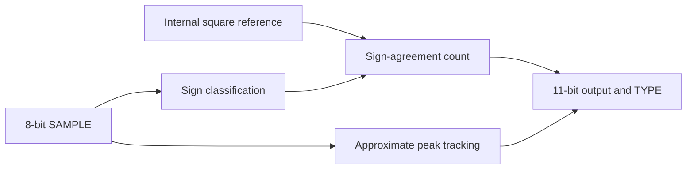

# Sign-Based Signal Demodulator

A synchronous digital core for phase-sensitive signal demodulation, combining sign-agreement counting with approximate peak-magnitude tracking.

[](https://github.com/BarryLee911/tt-sky-overlap-counter/actions/workflows/gds.yaml) [](https://github.com/BarryLee911/tt-sky-overlap-counter/actions/workflows/docs.yaml) [](https://github.com/BarryLee911/tt-sky-overlap-counter/actions/workflows/test.yaml) [](https://github.com/BarryLee911/tt-sky-overlap-counter/actions/workflows/equivalence.yaml)

The design accepts an unsigned 8-bit sample stream centered on code 128 and compares its sign with an internally generated square-wave reference. It exposes a phase-sensitive **COUNT** statistic and an approximate **MAGNITUDE** estimate. For a frequency-matched sinusoid, COUNT varies with relative phase; conversion to an angle depends on the phase convention and input conditions. The core outputs these two statistics, rather than a calibrated phase angle or a complete I/Q pair.

## Design at a glance

| Property | Implementation |
| --- | --- |
| Digital input | Unsigned 8-bit SAMPLE; zero level at 128 |
| COUNT | Sign agreements in a 2048-sample sliding window; saturated to 0–2047 |
| MAGNITUDE | Approximate peak of `abs(SAMPLE − 128)` over about 1024 samples; 0–128 |
| Sampling | LEVEL 0–23; one capture every `2^LEVEL` master clocks |
| Reference | One square-wave period per 2048 captured samples |
| Output | 11-bit data bus; TYPE alternates COUNT and MAGNITUDE every master clock |
| Implementation target | Tiny Tapeout SKY26d, SKY130, 6×2 tiles; 80 MHz build target |
| Evidence | RTL and gate-level regression, simulation-based cycle equivalence, and implementation reports; no silicon measurements reported |



## Reading and using the design

- [Architecture and numerical interpretation](docs/architecture.md): definitions, reference frequency, phase convention and pipeline behavior.
- [Pinout and operating instructions](docs/info.md): reset, configuration, pin handoff and output capture.
- [Validation and reproducibility](docs/validation.md): fixed-revision build evidence, local waveform observations and commands for the repository tests.
- [External ADC interface](docs/adc-interface.md): candidate parts and the required byte mapping, voltage translation and synchronization.
- [Layout viewer](https://barrylee911.github.io/tt-sky-overlap-counter/): generated physical implementation.

Configure LEVEL after reset, release the shared LEVEL[0]/TYPE pin before its 80000-clock handoff, and read TYPE with every result. Reset is required to change LEVEL. Adjacent COUNT and MAGNITUDE words need not describe the same sample instant. An ADC, analog conditioning and sample synchronization are external to this core.

## Validation status

The [recorded build at `1f28d70`](https://github.com/BarryLee911/tt-sky-overlap-counter/tree/1f28d70b04c08c91fa98e1ee7355492fa2102d49) passed GDS, precheck, gate-level test, viewer, RTL test, documentation and cycle-equivalence jobs. The [validation record](docs/validation.md) links each run and separates these checks from the additional ideal-input waveform experiments.

**80 MHz is an implementation target, not a demonstrated operating frequency.** The recorded build has a worst setup slack of −0.110671 ns and nonzero slew/fanout violations. Tiny Tapeout also specifies separate [GPIO frequency limits](https://tinytapeout.com/specs/gpio/). Passing CI does not establish all-corner timing closure, board-level performance or silicon operation.

## Reuse and citation

The HDL and associated repository material are distributed under [Apache-2.0](LICENSE). Citation metadata is provided in [CITATION.cff](CITATION.cff), using the maintainer's public account name. When reporting results, cite the repository **and the exact commit used**, and retain the corresponding workflow/artifact identifiers. The mutable `main` branch alone does not identify a reproducible implementation.

The current documented hardware source is `src/project.v`, SHA-256:

```text
279db397eecc4afd91e2f172e8bf21a465506f964cbf1438a8e865b14531323e
```

No publication DOI or silicon-measurement dataset is associated with this documentation yet.
